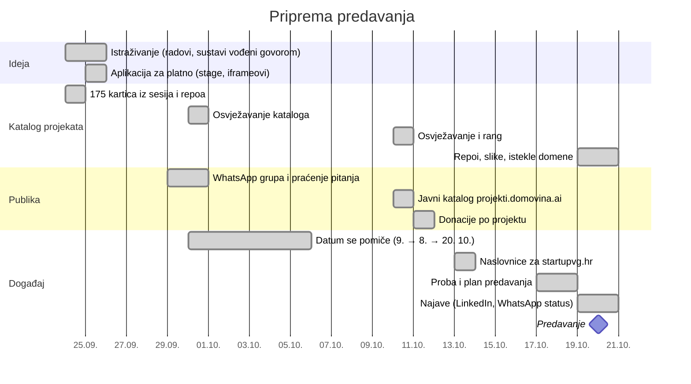
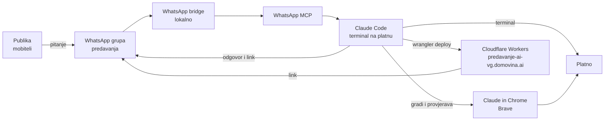
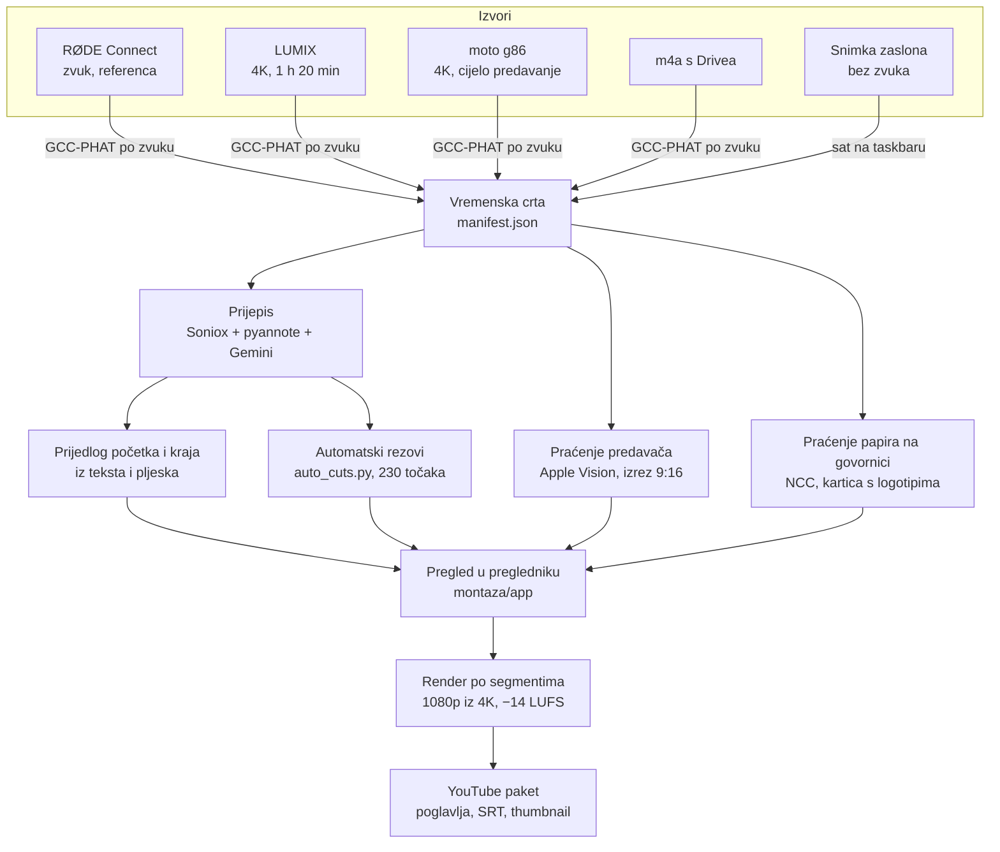

# Kako je nastalo

Predavanje „AI u praksi” (StartupVG, 20. 10. 2026.) od prve ideje do snimke na YouTubeu napravljeno je u razgovorima s Claude Codeom. Cijeli posao stao je u jedan radni repozitorij i 27 Claude Code sesija. Ova mapa je javni izvoz tog repozitorija.

## Brojke

| | |
|---|---|
| Razdoblje | 24. 9. – 28. 10. 2026. |
| Commitova u radnom repou | 87 |
| Claude Code sesija | 27 |
| Poruka koje sam napisao (uključujući slike) | ~250 |
| Poziva alata koje je Claude napravio | ~1.840 |
| od toga Claude in Chrome (preglednik) | ~300 |
| od toga WhatsApp MCP | ~100 |
| Model | Claude Opus 5.5 u svim sesijama |

Brojke su iz metapodataka sesija (vrijeme, broj poruka, imena alata), bez sadržaja razgovora. Sirove sesije nisu u repou, jer se u njima čitaju poruke iz WhatsApp grupe i razgovori s drugim ljudima.

## 1. Priprema

Početna ideja bila je prezentacija koja sama prati govor: ASR uživo sluša predavača i otvara projekt o kojem govori. Prije gradnje Claude je istražio postoji li to već, u znanstvenim radovima i open-source projektima ([`docs/research/`](docs/research/)). Na probi 17. 10. format se promijenio. Ostalo je 30 minuta izlaganja i 30 minuta pitanja, a katalog projekata bio je samo pozadina. Kartice projekata nastale su iz povijesti Claude Code sesija i lokalnih repozitorija. Na javni katalog išle su samo kartice koje sam označio kao `public`.

## 2. Uživo

Pitanja su se mogla postaviti naglas ili poslati u grupu. Claude je čitao grupu preko WhatsApp MCP-a, a terminal je cijelo vrijeme bio na platnu, pa je publika vidjela kako poruke stižu. Na pitanje iz grupe Claude je napravio web-stranicu izmišljene tvrtke s kontakt-formom ([`demo/web-tvrtka/`](demo/web-tvrtka/)), provjerio je u pregledniku, objavio na Cloudflare i poslao link u grupu. Od zadatka do linka prošlo je oko pola sata.

## 3. Montaža

- **Sinkronizacija.** Pet izvora poravnato je po zvuku prema RØDE snimci. Rezidual je ispod jednog framea (LUMIX 4,5 ms, moto 25 ms). Snimka zaslona nema zvuka, pa je poravnata po satu na Windows taskbaru.
- **Prijepis.** Soniox daje vremena riječi, pyannote govornike, a Gemini tekst po segmentu. Iz tog prijepisa nastali su titlovi i 36 poglavlja u opisu.
- **Rezovi.** Osnovni kadar je snimka zaslona s predavačem u izrezu 9:16. Od njega se odstupa samo s razlogom: pitanje iz publike, promjena na ekranu, predavač kod ekrana, ekran koji dugo miruje. Razlog piše uz svaku točku reza.
- **Papir s WiFi lozinkom** na govornici prati se kroz snimku i prekriva karticom s logotipima.
- **Render.** 230 segmenata renderira se paralelno iz 4K originala u 1080p. Cijeli render traje ~23 min. 4K verzija nije bila potrebna.
- **Objava.** Video, opis, titlove i thumbnail postavio je Claude kroz YouTube Studio u pregledniku. Za datoteku od 5 GB otvorio je sistemski prozor za odabir datoteke i upisao putanju preko AppleScripta, jer alat preglednika prima samo datoteke do 10 MB.

Detalji: [`docs/2026-10-26-montaza-sinkronizacija.md`](docs/2026-10-26-montaza-sinkronizacija.md).

## Tko je što odlučio

| Odluka | Čovjek | AI |
|---|---|---|
| Tema i format (bez slajdova, pitanja publike) | odlučio | |
| Prvo istražiti postoji li to već | tražio | pretražio radove i projekte, napisao sintezu |
| WhatsApp grupa za pitanja | ideja | skripta za praćenje, odgovori u grupi |
| Koji projekti idu javno (`public` / `review` / `private`) | odlučio po kartici | napravio kartice iz sesija i repoa, predložio rang |
| Promjena formata nakon probe (30 + 30 min) | odlučio | plan i slajdovi iz prijepisa probe |
| Demo uživo i domena | zadao u grupi | kod, provjera u pregledniku, deploy |
| Zvuk cijele snimke s RØDE-a | odlučio | izmjerio šum i glasnoću, podigao na −14 LUFS |
| Početak i kraj snimke | potvrdio | predložio iz prijepisa i pljeska |
| Rezovi između kamera i ekrana | pregledao u appu | pravila i 230 točaka reza |
| Javni repo kao čisti izvoz, bez povijesti | prihvatio | predložio, jer radni repo ima privatne kartice i prijepise |
| Objava na GitHub i vidljivost na YouTubeu | odlučuje | čeka izričit OK |
| 4K render | odlučio da ne treba | procijenio vrijeme i prostor |

## Stvarni promptovi

Ovo su doslovne poruke, s tipfelerima, jer većinu diktiram ili tipkam brzo. Lokalne putanje i nazivi računa zamijenjeni su opisom u uglatim zagradama.

**24. 9., prva poruka u repou**

> za osam dana imam predavanje o AI-ju medjutim najboji nacin za prezentiranje AI-ja je cista AI preznetacija, medjutim en staticna nego onda u kojoj se slajdovi nelinearno sami prebacuju […] ideja je prezentirati projekte koje smo radili u mnogim Cluade Code sessonima tijekom zadnjih godinun dana […] da se napravi u ovom codebaseu aplikacija koaj ce imati realtime ASR i znati sto prikazati na ekranu kao sljedecu stvar dok ja pricam

Iz toga su nastali: `docs(research): add topic reports on speech-driven presentation systems`, `feat(catalog): add 175 project cards from sessions and repos`, `feat(stage): add projector app with live iframes and camera`.

**29. 9., ideja s WhatsApp grupom**

> hmmm, razmisljam ja sad o necemu cool a to je da bih mogli napraviti WhatsApp grupu i da ljudi u nju salju pisanim putem pitanja i ti ih citas preko whatsapp mcp bridge i obradjujes, a pustio bih na ekran ovaj terminal da se tocno vidi kako ti poruke u whatsapp grupu dolaze […] a ta grupa ostaje kao trajni alat za komunikaciju s publikom

Commit: `feat(tools): prati WhatsApp grupu uživo za pitanja publike` (30. 9.).

**10. 10., javni katalog**

> sljdece pitanje da l mi imamom neki web app sa gridom gdje jednostavno mozemo otvarati svaki taj projekt i prikazati ga i to vec sad da je mozda negdje deployanon javno mozda na nekoj domovina.ai subdomeni preko Cloudflare Workers

Commit: `feat(app): javni grid projekata na projekti.domovina.ai`.

**20. 10., uživo na predavanju**

> ajde mi sad napraiv sljede imas na omovm kompu wranger CI u cloudflare acociuntun [račun] daj napraiv deployment na cloudflare workers i napravi da je ova jednostavna aplikacija dostupna na predavanje-ai-vg-.domovina.ai

Commit: `feat(demo): deploy weba tvrtke na predavanje-ai-vg.domovina.ai`. Sljedeća poruka bila je da napiše poruku s linkom i pošalje je u grupu.

**26. 10., početak montaže**

> e sad ako pogleda skripte u [lokalni repo producer.domovina.tv] unutra bi trebalo biti sve potrebnon da detektiras sve potrebnon za vremensku sinkronaizaciju svih video i audio trackova da se zna koliko je koji zamaknut […] zapisi u neku lokaknu datoteku manifest […] i napravi neku jednostavnun web aplikaciju na kojoj vidim trackove sa svime potrebnim da pregledam sve sto treba za montazu

Commit: `feat(montaza): sinkronizacija tragova, web app za pregled i transkript`.

**28. 10., cijeli render**

> ajde pusti cijeli renderer trenutnon na kompu ne radim nnista i outptu iskljucivo na nvanjski disk

Commit: `docs(montaza): render po segmentima, mjerenje šuma i glasnoće RØDE-a`. Render je trajao ~23 min.

## Kako sesije prelaze jedna u drugu

Kad razgovor postane predug, `/wrap-up` commita posao, zapiše što nije očito iz koda i spremi handoff za sljedeću sesiju. Nova sesija počinje porukom „nastavi handoff”. Zato je 27 kratkih sesija, a ne jedna duga, a znanje između njih je u `docs/` i commitovima, ne u memoriji modela.
