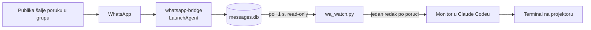

# Sync kataloga, Luma najava i WhatsApp pitanja publike

Stanje: 2026-09-30, zadnji sync kataloga 2026-10-10. Predavanje je u StartupVG inkubatoru (Podložnica 6, Velika
Gorica) u **utorak 20. 10. 2026. u 18:00**. Prvotno je bilo 2. 10., pa 9. 10., pa 8. 10., a konačno (2026-10-05) na 20. 10.

Vezani dokumenti: [`2026-10-19-katalog-repoi-slike-domene.md`](2026-10-19-katalog-repoi-slike-domene.md), [`docs/event/luma.md`](event/luma.md) (tekst eventa i
poruke), [`docs/research/README.md`](research/README.md) (zašto je automatski
"redatelj" bio plan) i [`tools/catalog/CARD_SCHEMA.md`](../tools/catalog/CARD_SCHEMA.md).

## Promjena smjera: ručno biranje umjesto AI redatelja

Govornik je 2026-09-29 odlučio ovako:

- publika ga **prekida i pita naglas**, a on sam bira što ide na platno
- automatski redatelj koji sluša govor **nije prioritet**, iako je istraživanje
  u `docs/research/` rađeno upravo oko njega
- cijelo predavanje snima **Wispr Flow** notetaker; pitanja se poslije analiziraju
  i odgovaraju pisano
- dodatni kanal je **WhatsApp grupa** u koju publika tiho šalje pitanja, a ta
  pitanja se pojavljuju na platnu

Posljedica: sljedeći posao je brzo **ručno** pretraživanje i prikaz kartica, a ne
okidanje iz transkripta.

## Kako napraviti sync kataloga

```bash
python3 tools/catalog/inventory.py   # ~18 s, 244 direktorija
python3 tools/catalog/group.py
python3 tools/catalog/build_inputs.py   # briše i ponovno piše data/card-inputs/
python3 tools/catalog/add_repos.py
# … osvježi kartice (agenti po CARD_SCHEMA.md) …
python3 tools/catalog/metrics.py      # git + sesije → data/metrics.json, ~15 s
python3 tools/catalog/rank.py         # upisuje `rank` u public kartice
python3 tools/catalog/finalize.py
npm run capture -- <id>               # snima urls.live[0]
```

**Redoslijed na webu** slijedi `rank`. Ocjena je pola semantičke važnosti iz
`data/importance.json` (ručno, 1–5, s obrazloženjem) i pola uloženog rada na log
skali: promptovi 30 %, dani s vlastitim commitovima 25 %, sesije 15 %, mjeseci
rada 15 % (do 12) i linije koda 15 % (do 100k). Nova public kartica mora dobiti
redak u `importance.json`, inače `rank.py` pukne. Commitovi datasetu,
committers.top i backupu su automatski, pa se ne broje; kod Cal.com instance i
XcodeBenchmarka je tuđi, pa se ne broje ni linije. Klubovi nemaju lokalni repo,
pa im se rad vidi samo kroz sesije.

Zamke:

- **Lažno "promijenjeno".** `card-inputs/*.last` je puni ISO timestamp, a
  `cards/*.stats.last` samo datum. Usporedba stringova zato javi ~130 promjena, a
  stvarnih je bilo 22. Uspoređuj `last[:10]` i rast `user_prompts`.
- **`data/prompts/<id>.txt` je prekinut na 80 KB.** Za domovina.ai, fetch i pay u
  njemu nema ništa novije od lipnja 2026. Nove promptove čitaj iz
  `~/.claude/projects/<dir>/*.jsonl`.
- **Capture snima `urls.live[0]`.** Ako na platnu treba podstranica (npr.
  `/glasanje`), stavi je prvu.
- **Premješteni repoi.** jedan repo je sada na
  vanjskom disku, pa putanja u card-inputu ne postoji.
- jedan repo ima `sessions: 0`, iako je rađen s Claude Codeom. Sesije su
  pokretane iz drugog direktorija, pa se broje tamo.

## Javni katalog: projekti.domovina.ai

Grid svih public kartica (`app/index.html`). Klik otvara projektor
(`app/stage.html`), a Esc vraća u grid. Lokalno: `npm run stage` → `/app/`
(`?all` uključuje i review kartice).

```bash
npm run deploy   # tools/deploy/build.py → dist/ + wrangler deploy (D.O.M. račun)
```

- `build.py` u `dist/` stavlja samo public kartice, bez `talk_hooks`, i miče
  `urls.repo` ako repo na GitHubu nije javan (4 takve kartice 2026-10-10).
- Worker je samo static assets, pa nema `/api/log`; `stage.js` logira samo na localhostu.
- `html_handling: auto-trailing-slash` preusmjerava `/stage.html` na `/stage`,
  a hash ostaje.
- Ugrađene Flutter stranice (domovina.ai) same uzmu fokus, pa tipke odlaze u
  iframe. `stage.js` vraća fokus projektoru dok interakcija (`e`) nije uključena.
- Nakon prvog deploya lokalni DNS je neko vrijeme pamtio NXDOMAIN; provjera ide s
  `curl --resolve projekti.domovina.ai:443:<cf ip>`.

## Brojke za javne objave: nikad iz inventure

Inventura vidi samo transkripte od ~travnja 2026., jer Claude Code briše starije
nakon 30 dana (`cleanupPeriodDays`). Prva Luma verzija je zato tvrdila "150+
projekata od travnja 2026.", a govornik je to s pravom odbio kao napuhano.

| Tvrdnja | Ispravno | Izvor |
|---|---|---|
| od kada | Claude Code od **2025-04** (Claude od 2025-02) | `~/git/stepanic/cv/data/generated/claude-code-stats.json` |
| sesije | **5.180** do 2026-09-26 (podcijenjeno, jer 2025. ima rupe) | isto |
| projekti | **34** javne kartice sa živom stranicom → "30+ živih" | `data/catalog.json` |

## WhatsApp pitanja publike (`tools/wa_watch.py`)



- Bridge je `~/git/mcps/whatsapp-mcp` (vidi `SETUP-ms.md`), a baza je
  `~/.local/share/whatsapp-mcp/store/messages.db`.
- U grupama je pošiljatelj **LID**, a ne broj. Ime daje
  `whatsmeow_contacts.their_jid = '<lid>@lid'` → `push_name`. Na platno ide samo
  prvo ime, nikad broj.
- MCP ne može stvoriti grupu. Govornik je stvara u aplikaciji, a invite link
  postaje QR na početnom ekranu.
- U grupi svi članovi vide brojeve drugih članova. To treba reći na slajdu s QR-om.
  Community announcement grupa skriva brojeve, ali u njoj pišu samo admini, pa ne
  odgovara za pitanja.
- Na platno ne ide ova radna sesija, nego **zasebna čista Claude Code sesija**, jer ova
  vidi CRM i inventuru svih repoa.
- Odgovaranje u grupu je slanje u govornikovo ime. Uživo se odgovara samo u
  terminalu, a pisani odgovori idu nakon predavanja, kad ih govornik pregleda.

## HD slike preko WhatsApp bridgea

Bridge šalje originalne bajtove, ali `.png` i `.jpg` idu kao ImageMessage. Za
sigurno očuvanje kvalitete isti file se šalje i kao ZIP. Svaka ekstenzija koja
nije slika ide kao DocumentMessage, pa je WhatsApp ne sažima. Coveri se renderiraju
u 2×, tj. 3200×3200.

## Otvoreno

- [ ] **Luma link od Domagoja.** Poslano mu je 2026-09-30 u 16:13. Kad stigne, poruka
      za CroAI grupe je u `docs/event/luma.md`, s mjestom za link.
- [ ] **WhatsApp grupa za predavanje.** Stvorena 19. 10. 2026. (link i QR u
      `docs/event/whatsapp-grupa/`). Ostaje proba s `wa_watch.py` kroz Monitor i QR slajd.
- [ ] **Čista sesija i konzola za predavanje.** Ručna pretraga kartica, a na platnu
      samo katalog i grupa.
- [ ] **Public kartice nisu pregledane za web.** Od 2026-10-10 su javno na
      projekti.domovina.ai, a `facts` i `description` pisani su za platno. Treba ih
      jednom proći s ciljem javne objave (`talk_hooks` se već izbacuje).
- [ ] **Redeploy nakon svakog synca.** `npm run deploy` ne ide automatski; katalog
      na webu je stanje od 2026-10-10 (redoslijed po `rank` deployan isti dan).
- [ ] **Semantičke ocjene u `data/importance.json` napisao je Claude.** Govornik ih
      još nije prošao; najlakše kroz `data/ranking.json`. Interni projekti s puno
      rada (DOMOVINA Storage 38., infrastruktura 42.) visoko su zbog rada; ako treba,
      `W_SEMANTIC` u `rank.py` s 0.5 na 0.6.
- [ ] **Kartica koja postane public** treba redak u `importance.json` i ponovni
      `metrics.py` → `rank.py` → `finalize.py` prije deploya.
- [ ] **Nove sesije bez kartice (sync 2026-10-10):** solardei, italk-fira-finance-private,
      italk-kreditna-sposobnost, pressflow, oscope, karta-validatora. Privatni su ili
      nemaju remote, pa su namjerno preskočeni.
- [ ] **65 kartica na reviewu** čekaju odluku (nisu u ovom repou).
- [ ] **Maksimir stranica pokazuje "1 glasač".** Ili treba više glasova do petka, ili
      naglasak na tome kako glasanje radi.
- [ ] **Repo nema remote.** Treba odluka želi li govornik private GitHub repo.
