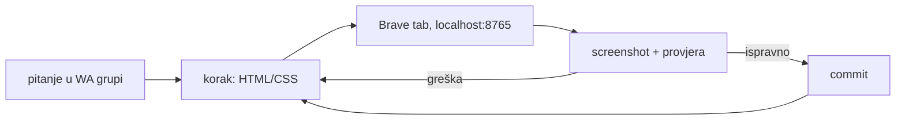

# Demo uživo: web tvrtke iz pitanja u WhatsApp grupi (20. 10. 2026.)

Na predavanju „AI u praksi” (StartupVG, 20. 10. 2026.) netko je u WhatsApp grupu
događaja ([ID grupe uklonjen]) postavio pitanje može li Claude napraviti
jednostavnu informativnu stranicu tvrtke s kontakt formom. Odgovor je napravljen
uživo u `demo/web-tvrtka/`: izmišljena „Stolarija Lipa”, čisti HTML i CSS, samo
sučelje (forma ništa ne šalje).

## Kako je rađeno

Četiri koraka, četiri commita (`106a6fc`, `0dbeb81`, `b80baa4`, `5ba2ae8`):
naslovni dio, zatim usluge i „o nama”, pa forma, na kraju mobitel. Ukupno oko 10 minuta.
Poslužitelj je `python3 -m http.server 8765` iz mape `demo/web-tvrtka/`.

## Zamke

- **Navigacija na `#sidro` ne učitava stranicu ponovno.** Prvi screenshot nakon izmjene
  pokazao je staru verziju. Za svježe učitavanje treba promijeniti query: `?v=N#sidro`.
- **Brave ne da prozor uži od ~500 px.** `resize_window(400)` daje viewport od 500 px.
  Za provjeru preljeva koristi se `document.documentElement.scrollWidth` u usporedbi s `innerWidth`.
- **JPEG screenshot na 0,6 skali** znao je pokazati „odrezan” rub inputa. `zoom` je
  potvrdio da je rub u redu. Prije popravka sitnog vizualnog nedostatka provjeri zoomom.
- **Tvoj broj u grupi nije uvijek „Me”.** Poruka poslana s mobitela pojavljuje se s
  LID-om `3835456151567` kao da ju je poslao netko drugi. Pitanje o web stranici
  došlo je s tog broja.

## Otvoreno

- Forma ne šalje mail. Za pravi rad treba je spojiti na Formspree ili na Cloudflare Worker s Email Sendingom.
- Odgovor u grupu sa screenshotom stranice nije poslan, čeka govornikov OK.
